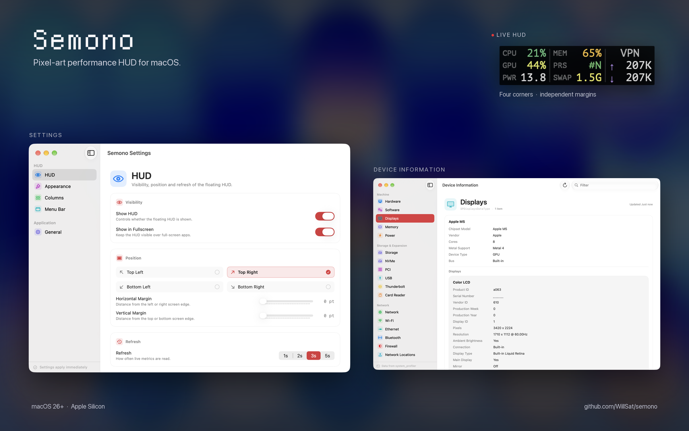

# Semono

A lightweight menu bar app with a floating pixel-art HUD for macOS.

<p align="center">
  
</p>

## Features

- Floating HUD with CPU, GPU, power, memory, memory pressure, swap, disk and network metrics.
- Four-corner positioning with independent horizontal and vertical margins, plus optional full-screen Spaces.
- Menu bar readout: CPU / GPU / PWR / MEM / PRS / NET / icon only, with a Show HUD toggle.
- Device Information window for browsing `system_profiler` categories, with search and grouped fields.
- Sampling follows what is on screen, so hidden surfaces do not keep their metrics alive.
- Native Settings window for appearance, columns, menu bar, position and startup.

## Languages

Emoji 🎉 · 简体中文 · 繁體中文 · English · 日本語 · 한국어 · Español

The default matches the system language and falls back to English when unsupported.

## Build

Requires macOS 26+ and an Xcode toolchain (Swift 6).

```bash
./build.sh debug
open .build/Semono.app
swift test
```

For a signed release:

```bash
SIGN_IDENTITY="Developer ID Application: Your Name (TEAMID)" ./build.sh release
```

## License

[MIT](LICENSE)
